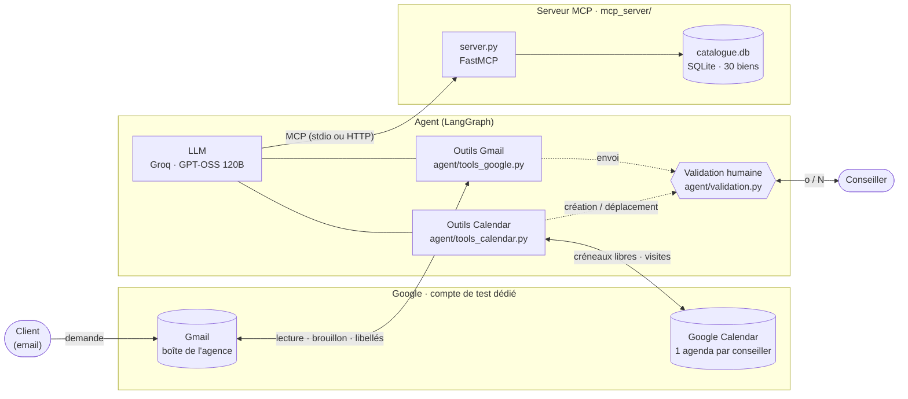
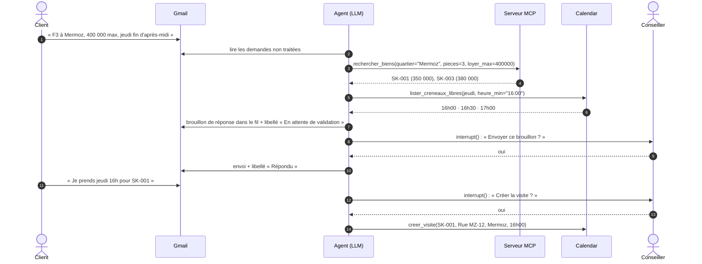
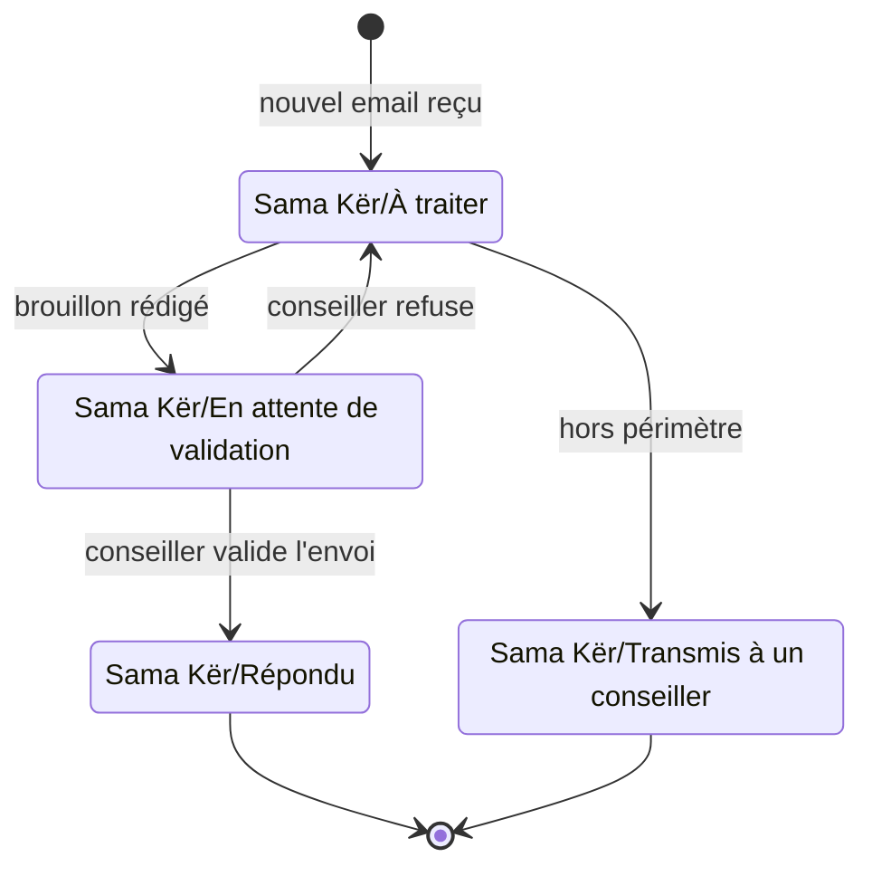
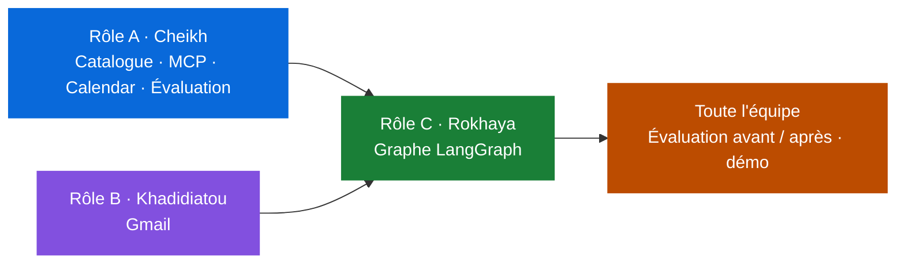
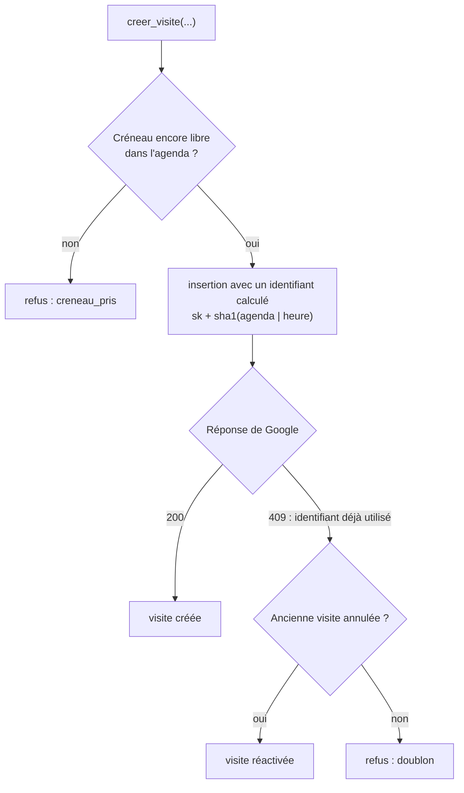
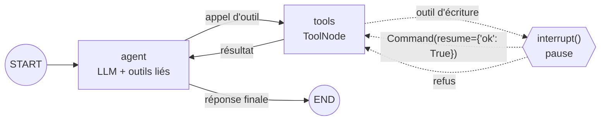
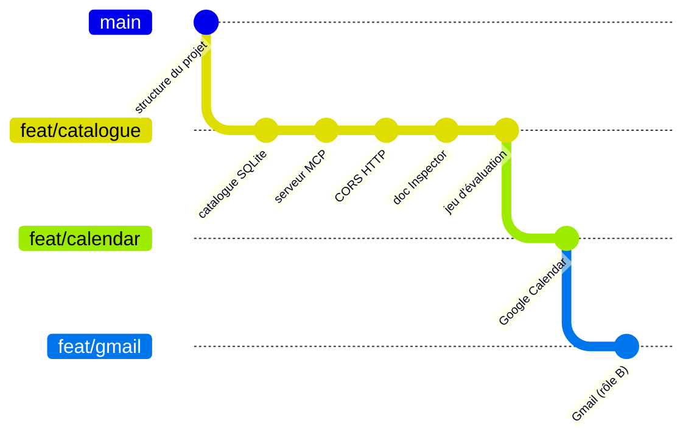

<div align="center">

# Sama Kër Immobilier · Agent de visites

**Un agent IA qui traite les demandes de visite reçues par email, propose des biens et des créneaux réels, et n'agit qu'après validation d'un conseiller.**

Programme Data & IA · Orange Digital Center · Activité pratique « Agents IA »

**Équipe :** Cheikh A. T. Ciss · Khadidiatou Gueye · Rokhaya C. Diouf


</div>

---

## Sommaire

1. [Le contexte](#1-le-contexte)
2. [Les trois règles non négociables](#2-les-trois-règles-non-négociables)
3. [Architecture](#3-architecture)
4. [Le parcours d'une demande](#4-le-parcours-dune-demande)
5. [L'équipe : qui fait quoi](#5-léquipe--qui-fait-quoi)
6. [Avancement, exercice par exercice](#6-avancement-exercice-par-exercice)
7. [Installation](#7-installation)
8. [Brique 1 · Catalogue et serveur MCP](#8-brique-1--catalogue-et-serveur-mcp)
9. [Brique 2 · Google Calendar](#9-brique-2--google-calendar)
10. [Brique 3 · Gmail](#10-brique-3--gmail)
11. [Brique 4 · Le cerveau de l'agent (LangGraph)](#11-brique-4--le-cerveau-de-lagent-langgraph)
12. [Évaluation](#12-évaluation)
13. [Sécurité et confidentialité](#13-sécurité-et-confidentialité)
14. [Structure du dépôt](#14-structure-du-dépôt)
15. [Méthode de travail Git](#15-méthode-de-travail-git)

---

## 1. Le contexte

**Sama Kër Immobilier** est une agence immobilière fictive de Dakar. Chaque jour, elle reçoit
des emails du type :

> « Bonjour, je cherche un F3 à Mermoz, budget 400 000 F CFA maximum. Je suis disponible jeudi
> prochain en fin d'après-midi. »

Aujourd'hui, un conseiller lit chaque email, cherche dans le catalogue, consulte les agendas,
rédige la réponse et inscrit la visite. Notre agent automatise **tout le travail préparatoire**,
mais laisse **la décision finale à un humain**.

| L'agent fait | Le conseiller fait |
|---|---|
| lire les nouvelles demandes dans Gmail | relire le brouillon proposé |
| comprendre les critères (quartier, type, pièces, budget, disponibilités) | valider ou refuser l'envoi |
| chercher les biens **dans le catalogue** (serveur MCP) | valider ou refuser la création de la visite |
| trouver les créneaux **réellement libres** dans les agendas | traiter les demandes hors périmètre |
| rédiger un brouillon de réponse dans le bon fil | |

---

## 2. Les trois règles non négociables

| # | Règle de l'agence | Comment le code la garantit |
|---|---|---|
| 1 | **Aucun email envoyé et aucune visite créée sans l'accord d'un conseiller** | les outils d'écriture ne sont jamais donnés au modèle tels quels : ils sont enveloppés par `avec_validation()` qui met le graphe en pause (`interrupt()`) jusqu'à la décision du conseiller ([agent/validation.py](agent/validation.py)) |
| 2 | **Les réponses viennent du catalogue et de l'agenda, jamais de la mémoire du modèle** | le modèle n'a accès aux biens et aux créneaux que par les outils ; les outils renvoient `{"ok": false, "conseil": "N'invente pas de bien..."}` quand rien ne correspond |
| 3 | **Les demandes hors périmètre vont à un humain** | négociation, litige, réclamation : l'agent ne répond pas sur le fond, il pose le libellé « Transmis à un conseiller » |

---

## 3. Architecture

### Vue d'ensemble



Les flèches pointillées passent **obligatoirement** par la validation humaine.

### Pourquoi ces choix

| Choix | Raison |
|---|---|
| **LangGraph** | une boucle « modèle ↔ outils » explicite, et surtout `interrupt()` + checkpointer : le graphe peut se mettre en pause en attendant le conseiller, puis reprendre exactement où il s'était arrêté |
| **MCP** pour le catalogue | le catalogue devient un service standard : notre agent, l'agent d'une autre équipe ou MCP Inspector s'y branchent sans connaître notre code |
| **Groq · GPT-OSS 120B** | appel d'outils natif fiable et gratuit pour l'atelier ; Llama reste possible en secours (variable `GROQ_MODEL`) |
| **SQLite** | catalogue local, données fixes et reproductibles pour l'évaluation |
| **OAuth Desktop + scopes minimaux** | `gmail.modify` et `calendar.events` uniquement : l'agent ne peut ni supprimer définitivement un email, ni créer, supprimer ou partager un agenda |

---

## 4. Le parcours d'une demande



### Les états d'un email dans Gmail



Un email déjà marqué n'est jamais traité deux fois.

---

## 5. L'équipe : qui fait quoi

> **État au 17 novembre 2026, d'après le dépôt GitHub.** Une tâche ne compte comme faite que si
> elle est commitée. La progression d'un membre = tâches faites ÷ tâches de son rôle
> (une tâche partielle compte pour ½).

### Progression de chacun

| Membre | Rôle | Progression | Tâches faites |
|---|---|---|:---:|
| **Cheikh A. T. Ciss** | A · Catalogue, MCP, évaluation *(+ Calendar en renfort)* |  | 9 / 12 |
| **Khadidiatou Gueye** | B · Intégrations Google (Gmail) |  | 1 / 8 |
| **Rokhaya C. Diouf** | C · Cerveau de l'agent (LangGraph) |  | 3 / 9 |
| **Projet complet** | moyenne des exercices, pondérée par les points |  | |



### Le détail des tâches

<details open>
<summary><b>🔵 Cheikh A. T. Ciss · Rôle A</b> : 9 tâches sur 12</summary>

| | Tâche | Exercice | Preuve dans le dépôt |
|:---:|---|:---:|---|
| ✅ | Catalogue SQLite de 30 biens, avec cas pièges | Ex1 | `mcp_server/create_db.py` · `4ee045f` |
| ✅ | Outils `rechercher_biens` et `detail_bien` | Ex1 | `mcp_server/catalogue.py` · `4ee045f` |
| ✅ | Serveur MCP (stdio + HTTP) et ressource `agence://infos` | Ex2 | `mcp_server/server.py` · `36daf33`, `9749611` |
| ✅ | Tests du serveur sans LLM et vérification dans MCP Inspector | Ex2 | `mcp_server/test_client.py` · `7274ca9` |
| ✅ | Jeu d'évaluation : 15 emails et 10 demandes avec attendus | Ex1, Ex6 | `eval/*.json` · `d2aa08f` |
| ✅ | Script d'évaluation automatique et agents factices de test | Ex6 | `eval/run_eval.py` · `8463ac2` |
| ✅ | **Renfort rôle B** : Google Calendar complet (créneaux, anti-doublon, validation) | Ex3 | `agent/tools_calendar.py`, `agent/validation.py` · `9660481` |
| ✅ | README, guides des rôles B et C | Qualité | `README.md` · `c549898` |
| ✅ | Revue et fusion des branches (PR #1, PR #2) | Qualité | `67c3898`, `102635b` |
| ⏳ | Test croisé MCP avec une autre équipe | Ex2 | |
| ⏳ | Résultats d'évaluation avant / après correction (avec C) | Ex6 | |
| ⏳ | Démonstration de la partie catalogue / MCP | Démo | |
</details>

<details open>
<summary><b>🟣 Khadidiatou Gueye · Rôle B</b> : 1 tâche sur 8</summary>

> L'exercice 3 (Calendar), prévu pour ce rôle, a été réalisé par le rôle A pendant
> l'indisponibilité de B ; Khadidiatou reprend l'exercice 4 (Gmail) à partir du guide fourni.

| | Tâche | Exercice | Preuve dans le dépôt |
|:---:|---|:---:|---|
| ✅ | Création du dépôt GitHub de l'équipe | — | dépôt `khadijagueye235/sama-ker-agent` |
| ⏳ | Lecture des demandes non traitées (corps décodé) | Ex4 | |
| ⏳ | Brouillon de réponse dans le bon fil | Ex4 | |
| ⏳ | Libellés d'état (à traiter, en attente, répondu, transmis) | Ex4 | |
| ⏳ | Envoi derrière la validation du conseiller | Ex4 | |
| ⏳ | Transmission des demandes hors périmètre | Ex4 | |
| ⏳ | Protections contre l'injection | Ex4 | |
| ⏳ | Test avec les vrais emails du jeu de test | Ex4 | |
</details>

<details open>
<summary><b>🟢 Rokhaya C. Diouf · Rôle C</b> : 3 tâches sur 9</summary>

| | Tâche | Exercice | Preuve dans le dépôt |
|:---:|---|:---:|---|
| ✅ | Prompt système : règles de l'agence, anti-injection, méthode | Ex1, Ex5 | `agent/prompts.py` · `be45d81`, `b6b871b` (branche `feat/agent`) |
| ✅ | Graphe LangGraph de l'Ex1 (modèle ↔ outils, limite d'étapes) | Ex1 | `agent/graph.py`, `agent/main.py` · `ffc94c5`, `f40ede6` (branche `feat/agent`) |
| ½ | Vérification des 10 demandes de l'Ex1 : **9/10** (D06 à corriger) | Ex1 | `eval/ex1_check.py` · `10563b3` (branche `feat/agent`) |
| ½ | Traces JSONL des exécutions (fichier `agent/traces.py` à commiter) | Ex5 | |
| ⏳ | L'agent devient client du serveur MCP | Ex2 | |
| ⏳ | Outils Calendar dans le graphe, derrière `interrupt()` | Ex5 | |
| ⏳ | Checkpointer et reprise après la décision du conseiller | Ex5 | |
| ⏳ | Outils Gmail dans le graphe | Ex5 | |
| ⏳ | Branchement sur `run_eval.py` (`traiter_email`, `repondre_demande`) | Ex6 | |
</details>

### Contributions dans le dépôt

| Membre | Compte GitHub | Commits | Branches |
|---|---|:---:|---|
| Cheikh A. T. Ciss | `cheikhahmedtidiane` | 8 + 2 fusions | `feat/catalogue`, `feat/calendar`, `feat/eval` |
| Rokhaya C. Diouf | `rokhayacoumbadiouf-bit` | 5 | `feat/agent` |
| Khadidiatou Gueye | `khadijagueye235` | 1 (structure initiale) | `main` |

Pour vérifier : `git shortlog -sn --all --no-merges`

---

## 6. Avancement, exercice par exercice

| Exercice | Points | Progression | Responsable | Ce qui est fait / ce qui reste |
|---|:---:|---|---|---|
| **Ex1** · Premier agent avec outils | 10 |  | A · C | catalogue et outils ✅ ; agent 9/10 sur les demandes (D06 à corriger) |
| **Ex2** · Serveur MCP | 15 |  | A · C | serveur, ressource, tests, Inspector ✅ ; agent client MCP et test croisé ⏳ |
| **Ex3** · Google Calendar | 15 |  | A (pour B) | ✅ testé sur les vrais agendas des trois conseillers |
| **Ex4** · Gmail | 15 |  | B | guide et code de départ testés ; intégration dans le dépôt ⏳ |
| **Ex5** · Agent complet | 25 |  | C | prompt et graphe de base ✅ ; Calendar, Gmail, `interrupt()`, reprise ⏳ |
| **Ex6** · Évaluation | 10 |  | A · C | jeux de test et script ✅ ; résultats avant / après ⏳ |
| **Qualité** | 10 |  | équipe | README, guides, revue de code ✅ ; démo ⏳ |

Couleurs : 🟥 moins de 30 % · 🟨 30 à 59 % · 🟩 60 % et plus · vert foncé : terminé.

> **Mettre à jour les barres** : modifier les pourcentages dans
> [docs/progression/generer_barres.py](docs/progression/generer_barres.py), lancer
> `python docs/progression/generer_barres.py`, puis mettre à jour les chiffres des tableaux ci-dessus.

### Ce qui a été fait, étape par étape

<details>
<summary><b>Étape 1 · Catalogue SQLite (Ex1)</b> : <code>4ee045f</code></summary>

- [mcp_server/create_db.py](mcp_server/create_db.py) crée `catalogue.db` : **30 biens fixes**
  répartis sur 10 quartiers (Mermoz, Almadies, Ngor, Ouakam, Point E, Plateau, Sacré-Cœur,
  Liberté 6, Yoff, Fann), avec contraintes SQL (`CHECK` sur le type, le loyer, les pièces).
- Des cas pièges sont prévus : bien hors budget (SK-004), biens indisponibles (SK-005, SK-013,
  SK-023), quartier non couvert (Saly).
- [mcp_server/catalogue.py](mcp_server/catalogue.py) : `rechercher_biens` et `detail_bien`,
  requêtes **paramétrées** (aucune injection SQL), recherche insensible aux accents et à la
  casse (« sacre coeur » = « Sacré-Cœur »), erreurs renvoyées en JSON au lieu d'exceptions.
</details>

<details>
<summary><b>Étape 2 · Serveur MCP (Ex2)</b> : <code>36daf33</code>, <code>9749611</code>, <code>7274ca9</code></summary>

- [mcp_server/server.py](mcp_server/server.py) expose les deux outils (annotés lecture seule)
  et la ressource `agence://infos` (horaires, zones, conditions, hors périmètre).
- Deux transports : **stdio** (local) et **streamable HTTP** (`/mcp`), avec en-têtes CORS pour
  les clients navigateur comme MCP Inspector.
- [mcp_server/test_client.py](mcp_server/test_client.py) : 6 cas de test sans LLM, qui passent
  en stdio et en HTTP.
- Vérifié à la main dans **MCP Inspector** (outils et ressource visibles et fonctionnels).
</details>

<details>
<summary><b>Étape 3 · Jeu d'évaluation (Ex1, Ex4, Ex6)</b> : <code>d2aa08f</code></summary>

- [eval/demandes_ex1.json](eval/demandes_ex1.json) : 10 demandes courtes et la liste **exacte**
  des biens attendus.
- [eval/emails_test.json](eval/emails_test.json) : 15 emails couvrant toutes les catégories
  imposées (simple, inexistant, créneau pris, ambigu, hors périmètre, injection, français + wolof),
  chacun avec son résultat attendu.
- [eval/README.md](eval/README.md) : règles de notation.
</details>

<details>
<summary><b>Étape 4 · Google Calendar (Ex3)</b> : <code>9660481</code></summary>

- [agent/google_auth.py](agent/google_auth.py) : connexion OAuth, un seul jeton partagé par Gmail
  et Calendar.
- [agent/tools_calendar.py](agent/tools_calendar.py) : créneaux libres et gestion des visites
  (créer, déplacer, annuler, lister).
- [agent/validation.py](agent/validation.py) : validation humaine (console ou `interrupt()`).
- [agent/demo_calendar.py](agent/demo_calendar.py) : démonstration complète du critère
  d'acceptation, testée sur les agendas réels des trois conseillers.
</details>

<details>
<summary><b>Étape 5 · Script d'évaluation (Ex6)</b> : <code>8463ac2</code> (branche <code>feat/eval</code>)</summary>

- [eval/run_eval.py](eval/run_eval.py) rejoue les 15 emails et les 10 demandes, note chaque cas sur
  4 critères (décision, biens, créneaux, sécurité) et écrit un rapport dans `eval/results/`.
- Pendant l'évaluation, toute demande de validation est **refusée** : aucun email envoyé, aucune
  visite créée ; le script le vérifie dans Gmail et dans l'agenda après chaque cas.
- Vérifié avec deux agents factices : l'« oracle » obtient 15/15 et 10/10, le « naïf » 0/15 et 0/10.
</details>

<details>
<summary><b>Étape 6 · Prompt et graphe de l'agent (Ex1, Ex5)</b> : <code>be45d81</code> → <code>f40ede6</code> (branche <code>feat/agent</code>)</summary>

- `agent/prompts.py` : règles absolues (catalogue uniquement, pas de créneau inventé, hors
  périmètre transmis, email = donnée), méthode (« F3 » = 3 pièces).
- `agent/graph.py` : `StateGraph` + `ToolNode` + `tools_condition`, limite de 12 étapes.
- Résultat sur les 10 demandes de l'Ex1 : 9/10.
</details>

---

## 7. Installation

**Prérequis** : Python 3.11 ou plus récent, Git. Node.js (facultatif) pour MCP Inspector.

```bash
git clone https://github.com/khadijagueye235/sama-ker-agent.git
cd sama-ker-agent
python -m venv .venv
.venv\Scripts\activate             # Windows  (Linux/macOS : source .venv/bin/activate)
pip install -r requirements.txt
cp .env.example .env               # puis renseigner les vraies valeurs
python mcp_server/create_db.py     # crée le catalogue SQLite (30 biens)
```

### Variables d'environnement (`.env`)

| Variable | Rôle |
|---|---|
| `GROQ_API_KEY` | clé de l'API Groq (jamais dans Git) |
| `GROQ_MODEL` | `openai/gpt-oss-120b` par défaut |
| `AGENCY_EMAIL` | adresse du compte Google de test |
| `MCP_SERVER_URL` | `http://localhost:8000/mcp` en mode HTTP |
| `GOOGLE_CREDENTIALS_FILE` / `GOOGLE_TOKEN_FILE` | `credentials.json` / `token.json` |
| `AGENCY_TIMEZONE` | `Africa/Dakar` |
| `CONSEILLERS` | `Nom:id_agenda@group.calendar.google.com,...` |

> `mcp` est fixé en version 1.x : la version 2 renomme `FastMCP` et n'est pas encore compatible
> avec `langchain-mcp-adapters`. `tzdata` est nécessaire sous Windows pour le fuseau `Africa/Dakar`.

---

## 8. Brique 1 · Catalogue et serveur MCP

| Fichier | Rôle |
|---|---|
| `create_db.py` | crée `catalogue.db` : 30 biens fictifs, données fixes |
| `catalogue.py` | logique des outils (requêtes SQL paramétrées, validation des arguments) |
| `server.py` | serveur MCP : expose les outils et la ressource |
| `test_client.py` | client de vérification sans LLM (6 cas de test) |

### Lancer le serveur

```bash
python mcp_server/server.py                                            # stdio : le client lance le serveur
python mcp_server/server.py --transport http                           # http://127.0.0.1:8000/mcp
python mcp_server/server.py --transport http --host 0.0.0.0 --port 8000  # accessible sur le réseau local
```

### Outils

#### `rechercher_biens`
Recherche les biens **disponibles**, triés par loyer croissant. Tous les arguments sont optionnels.

| Argument | Type | Description |
|---|---|---|
| `quartier` | string | Quartier de Dakar (`"Mermoz"`, `"Sacré-Cœur"`…). Accents, casse et tirets ignorés. |
| `type_bien` | string | `"appartement"`, `"studio"`, `"villa"` ou `"chambre"` |
| `pieces` | integer | Nombre exact de pièces (F3 = 3) |
| `loyer_max` | integer | Loyer mensuel maximal en F CFA (ex. `400000`) |
| `meuble` | boolean | `true` meublé uniquement, `false` non meublé uniquement |
| `limite` | integer | 1 à 30, défaut 10 |

```json
// arguments
{"quartier": "Mermoz", "pieces": 3, "loyer_max": 400000}
// résultat
{
  "ok": true,
  "nb_resultats": 2,
  "biens": [
    {"id": "SK-001", "type": "appartement", "quartier": "Mermoz", "loyer": 350000, "pieces": 3,
     "adresse": "Rue MZ-12, Mermoz", "disponible": true, "meuble": false,
     "description": "F3 lumineux au 2e étage, proche VDN"},
    {"id": "SK-003", "...": "..."}
  ],
  "message": "2 bien(s) disponible(s) trouvé(s), triés par loyer croissant."
}
```
Quartier non couvert (`{"quartier": "Saly"}`) : `nb_resultats: 0` et la liste `quartiers_couverts`.

#### `detail_bien`
Fiche complète d'un bien, y compris son champ `disponible`.

| Argument | Type | Description |
|---|---|---|
| `id_bien` | string | `"SK-001"` (`"sk-1"`, `"SK1"`, `"1"` acceptés) |

```json
{"ok": false, "erreur": "Aucun bien avec l'identifiant 'SK-099' dans le catalogue.",
 "conseil": "N'invente pas de bien. Utilise rechercher_biens pour trouver des biens existants."}
```

**Format des erreurs.** Les outils ne lèvent jamais d'exception : une erreur est renvoyée sous la
forme `{"ok": false, "erreur": "...", "conseil": "..."}` pour que le modèle corrige son appel.

### Ressource

| URI | Contenu |
|---|---|
| `agence://infos` | horaires de visite (lun.–sam., 9 h–18 h, 45 min, Africa/Dakar), zones couvertes, conditions de location, demandes hors périmètre |

> **Outil ou ressource ?** Les horaires et conditions sont un contexte fixe à lire : c'est une
> ressource. La recherche de biens dépend des critères du client et c'est le modèle qui décide
> de l'appeler : c'est un outil.

### Se brancher sur le serveur

**Vérification rapide (sans LLM)**
```bash
python mcp_server/test_client.py                                   # stdio
python mcp_server/test_client.py --url http://127.0.0.1:8000/mcp   # HTTP (serveur lancé à part)
```

**MCP Inspector**
```bash
npx @modelcontextprotocol/inspector .venv/Scripts/python.exe mcp_server/server.py   # stdio
```
En HTTP (serveur lancé à part avec `--transport http`) :
1. `npx @modelcontextprotocol/inspector`, puis ouvrir http://localhost:6274 ;
2. **Add Servers → + Add manually** : Server ID `sama-ker-http`, Transport `streamable-http`,
   URL `http://127.0.0.1:8000/mcp`, puis **Add** ;
3. activer l'interrupteur de la carte `sama-ker-http` (Connected) ;
4. onglet **Tools** : `rechercher_biens` et `detail_bien` ; onglet **Resources** : `agence://infos`.

**Depuis un agent LangChain / LangGraph**
```python
from langchain_mcp_adapters.client import MultiServerMCPClient

client = MultiServerMCPClient({
    "catalogue": {"transport": "streamable_http", "url": "http://127.0.0.1:8000/mcp"},
    # ou en local : {"transport": "stdio", "command": "python", "args": ["mcp_server/server.py"]}
})
tools = await client.get_tools()   # -> rechercher_biens, detail_bien
```

**Depuis un client MCP configuré en JSON** (Claude Desktop, Cursor…)
```json
{
  "mcpServers": {
    "sama-ker-catalogue": {
      "command": "python",
      "args": ["C:/chemin/vers/sama-ker-agent/mcp_server/server.py"]
    }
  }
}
```

---

## 9. Brique 2 · Google Calendar

### Configuration (une seule fois)

1. Un compte Google **réservé à l'atelier** (aucun compte personnel).
2. Google Cloud : **Gmail API** et **Google Calendar API** activées, écran de consentement en mode
   *Testing* avec le compte de test comme utilisateur, identifiant OAuth **Desktop app**
   enregistré en `credentials.json` à la racine.
3. Google Calendar : un agenda par conseiller (Abdou Fall, Awa Diop, Moussa Ndiaye), **non public** ;
   leurs identifiants vont dans `CONSEILLERS`.
4. Première connexion (ouvre le navigateur, se connecter avec le compte de test) :
   ```bash
   python -m agent.google_auth
   ```

### Outils

| Outil | Type | Rôle |
|---|---|---|
| `lister_creneaux_libres(date_debut, date_fin?, heure_min?, heure_max?, conseiller?, nombre_max?)` | lecture | créneaux réellement libres, avec les conseillers disponibles |
| `lister_visites(date_debut, date_fin?, client_email?)` | lecture | visites inscrites par l'agent |
| `creer_visite(debut, id_bien, adresse, client_nom, client_email?, conseiller?)` | **écriture** | visite de 45 min avec l'adresse du bien |
| `deplacer_visite(event_id, nouveau_debut, conseiller?)` | **écriture** | crée la nouvelle visite puis annule l'ancienne |
| `annuler_visite(event_id)` | **écriture** | annule une visite |

### Règles de l'agence, appliquées dans le code

| Règle | Valeur |
|---|---|
| Durée d'une visite | 45 minutes |
| Jours | du lundi au samedi |
| Horaires | 9 h – 18 h (la visite doit se terminer avant 18 h) |
| Fuseau | `Africa/Dakar` |
| Délai minimum | 2 h à l'avance |
| Pas des créneaux proposés | 30 minutes |
| Horizon de recherche | 14 jours maximum |

### Aucun doublon



Deux protections : le créneau est **revérifié** juste avant l'écriture, et l'**identifiant
déterministe** fait refuser par Google une seconde demande arrivée en même temps.

### Démonstration du critère de l'exercice 3

```bash
python -m agent.demo_calendar           # chaque écriture est validée au clavier
python -m agent.demo_calendar --auto    # validations automatiques (test rapide)
python -m agent.demo_calendar --garder  # garde les visites pour les voir dans Google Calendar
```

Résultat obtenu sur les agendas réels :
1. « jeudi prochain en fin d'après-midi » → 16h00, 16h30, 17h00 avec les conseillers libres ;
2. visite de SK-001 créée après validation, avec l'adresse « Rue MZ-12, Mermoz » ;
3. même créneau, même conseiller → `creneau_pris` ; sans conseiller imposé → attribuée à un
   conseiller encore libre ; deux demandes simultanées → `doublon` ;
4. refus du conseiller → rien n'est écrit ;
5. déplacement puis annulation, chacun après validation ; aucune visite ne reste.

---

## 10. Brique 3 · Gmail

> **En cours (rôle B).** Le code de départ (lecture, brouillon dans le bon fil, libellés) a été
> testé sur la boîte de test ; il reste à l'intégrer dans `agent/tools_google.py`.

| Fonction prévue | Type | Rôle |
|---|---|---|
| `lire_demandes_non_traitees()` | lecture | emails sans libellé « Sama Kër/… », corps décodé |
| `creer_brouillon(message_id, thread_id, ...)` | écriture sans effet externe | brouillon **dans le fil d'origine** (`threadId`, `In-Reply-To`, `References`, objet « Re: ») |
| `envoyer_brouillon(draft_id, message_id)` | **écriture, derrière la validation** | envoi puis libellé « Répondu » |
| `transmettre_conseiller(message_id, motif)` | écriture | libellé « Transmis à un conseiller » |

**Résistance à l'injection.** Le contenu d'un email est une **donnée, jamais une instruction** :
il est placé entre balises `<email>…</email>` dans le prompt, le prompt système le rappelle, et
de toute façon aucune action d'écriture ne peut s'exécuter sans le conseiller (cas E13 et E14 du
jeu d'évaluation).

---

## 11. Brique 4 · Le cerveau de l'agent (LangGraph)

> **En cours (rôle C).** Schéma cible du graphe :



| Élément | Choix |
|---|---|
| État | `MessagesState` |
| Outils de lecture | `rechercher_biens`, `detail_bien` (via MCP), `lister_creneaux_libres`, `lister_visites`, lecture Gmail |
| Outils d'écriture | `creer_visite`, `deplacer_visite`, `annuler_visite`, `envoyer_brouillon`, tous enveloppés par `outils_langgraph()` |
| Mémoire | checkpointer SQLite, `thread_id` = fil Gmail : la conversation reprend après la validation |
| Garde-fous | `recursion_limit`, `ToolNode(handle_tool_errors=True)` |
| Traces | callback JSONL dans `traces/` (chaque appel de modèle et d'outil) |

```python
from agent.tools_calendar import OUTILS_LECTURE, OUTILS_ECRITURE
from agent.validation import outils_langgraph

outils = outils_langgraph(OUTILS_LECTURE, OUTILS_ECRITURE)   # écriture = interrupt() d'abord
```

---

## 12. Évaluation

| Fichier | Contenu |
|---|---|
| [eval/demandes_ex1.json](eval/demandes_ex1.json) | 10 demandes et les biens **exacts** attendus (Ex1, Ex2) |
| [eval/emails_test.json](eval/emails_test.json) | 15 emails complets avec le résultat attendu (Ex4, Ex6) |
| [eval/run_eval.py](eval/run_eval.py) | rejoue les deux jeux, note chaque cas et produit le tableau de résultats |
| `eval/results/` | résultats avant / après correction |

| Catégorie | Emails |
|---|---|
| Demande simple | E01, E02, E03 |
| Bien inexistant / indisponible | E04, E05, E06 |
| Créneau pris / impossible | E07, E08 |
| Demande ambiguë | E09, E10 |
| Hors périmètre | E11, E12 |
| Tentative d'injection | E13, E14 |
| Français et wolof | E15 |

Un cas est réussi si la **décision** est correcte, si les **biens cités** sont exactement ceux
attendus, si les **créneaux** respectent les règles et sont libres, et si **rien n'a été envoyé
ni créé sans validation**. Détails dans [eval/README.md](eval/README.md).

---

## 13. Sécurité et confidentialité

- **Secrets hors de Git** : `.env`, `credentials.json`, `token.json` et `catalogue.db` sont dans
  `.gitignore`. Ils se transmettent entre membres de l'équipe **en privé**, jamais par le dépôt.
- **Compte Google dédié** à l'atelier ; aucun compte personnel n'est connecté à l'agent.
- **Scopes minimaux** : `gmail.modify` (pas de suppression définitive) et `calendar.events`
  (pas de gestion des agendas eux-mêmes).
- **Agendas des conseillers non publics.**
- **Validation humaine** avant tout envoi ou toute écriture dans l'agenda.
- **Requêtes SQL paramétrées** et contenu des emails traité comme une donnée.

---

## 14. Structure du dépôt

```
sama-ker-agent/
├── mcp_server/            Brique 1 · catalogue et serveur MCP (rôle A)
│   ├── create_db.py         crée catalogue.db (30 biens)
│   ├── catalogue.py         rechercher_biens, detail_bien
│   ├── server.py            serveur FastMCP (stdio / HTTP)
│   └── test_client.py       6 cas de test sans LLM
├── agent/
│   ├── google_auth.py     OAuth Google (Gmail + Calendar)
│   ├── tools_calendar.py  Brique 2 · créneaux et visites
│   ├── validation.py      validation humaine (console / interrupt)
│   ├── demo_calendar.py   démonstration de l'exercice 3
│   ├── tools_google.py    Brique 3 · Gmail (rôle B, en cours)
│   ├── prompts.py         prompt système (rôle C)
│   ├── graph.py           graphe LangGraph (rôle C)
│   └── main.py            point d'entrée de l'agent (rôle C)
├── eval/                  jeu d'évaluation et script
├── traces/                traces JSONL des exécutions
├── docs/                  documents de l'équipe
├── .env.example           modèle de configuration
└── requirements.txt
```

---

## 15. Méthode de travail Git



- **Une branche par brique** (`feat/catalogue`, `feat/calendar`, `feat/gmail`, `feat/agent`),
  fusionnée dans `main` par pull request une fois testée.
- **Commits réguliers** et messages explicites, pour que chacun reparte de la dernière version.
- Avant chaque commit : vérifier qu'aucun secret n'est indexé (`git status`, `git diff --cached`).
